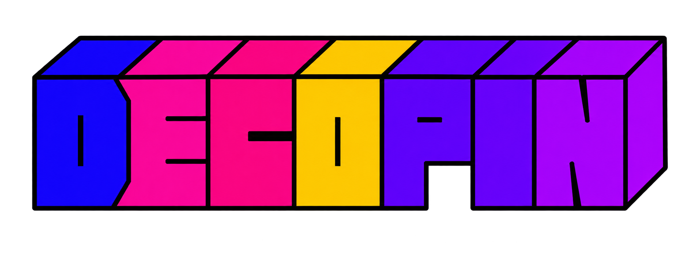

<div align="center">
  <a href="https://yuyakinjo.github.io/decopin-cli/">
    
  </a>
  <h1>decopin-cli</h1>

[](https://www.npmjs.com/package/decopin-cli)
[](https://www.npmjs.com/package/decopin-cli)

</div>

Build CLIs the way Next.js builds web apps: file conventions, JSX output, and
types that come from your declarations. TypeScript + Bun.

```tsx
// app/hello/cmd.tsx

import { type CmdProps, Line, Text } from 'decopin-cli';

export default function Command({ args }: CmdProps<'hello'>) {
  return (
    <Line>
      <Text bold color="green">
        hello, {args.name}
      </Text>
    </Line>
  );
}
```

## Getting Started

```sh
bunx decopin-cli init my-cli
cd my-cli
bun run build
./dist/index.js hello          # hello, world
```

## Documentation

Visit **[Document](https://yuyakinjo.github.io/decopin-cli/)** to view the full documentation.

## License

MIT
